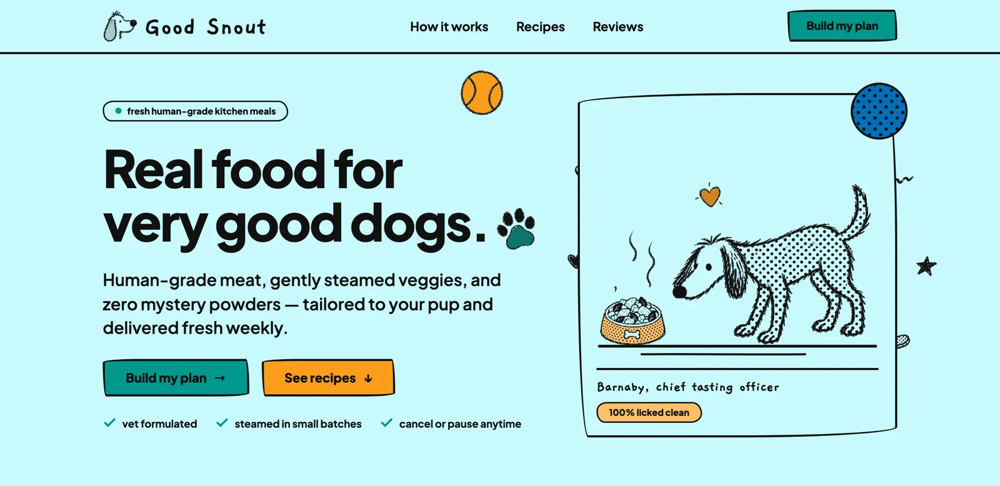
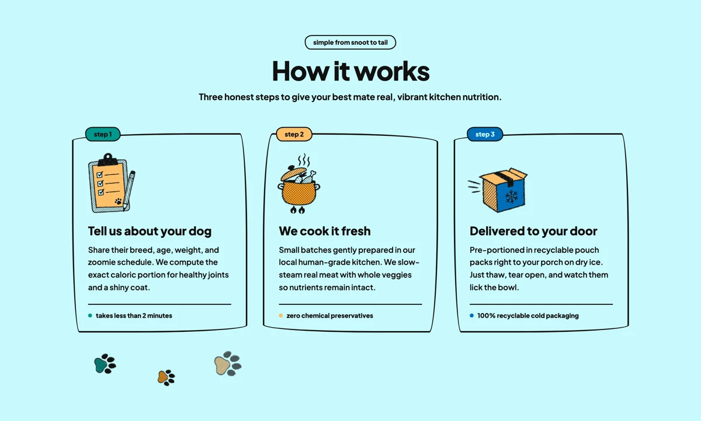
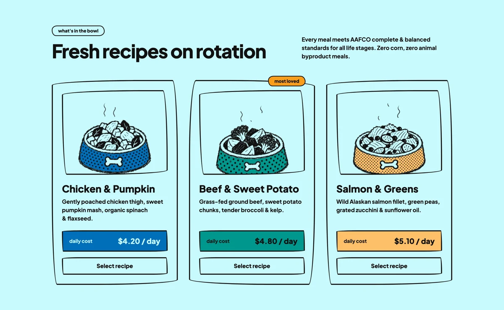
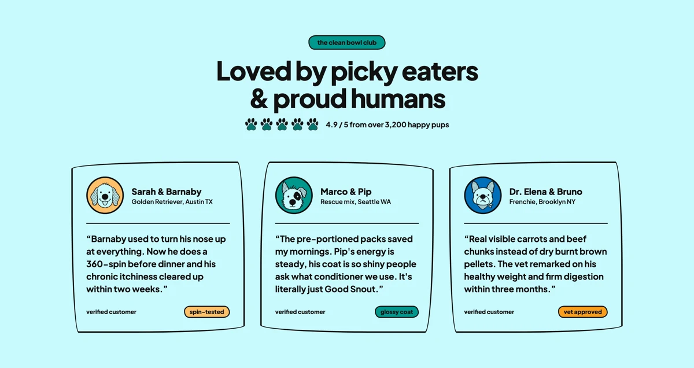
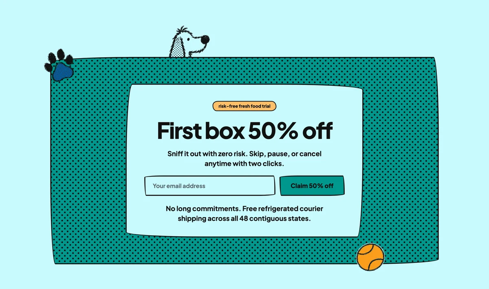
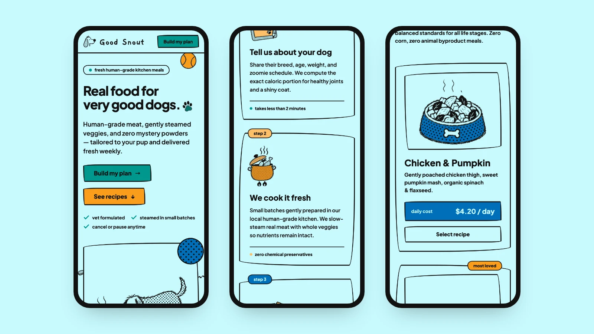
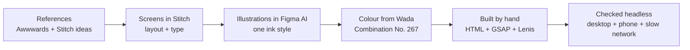
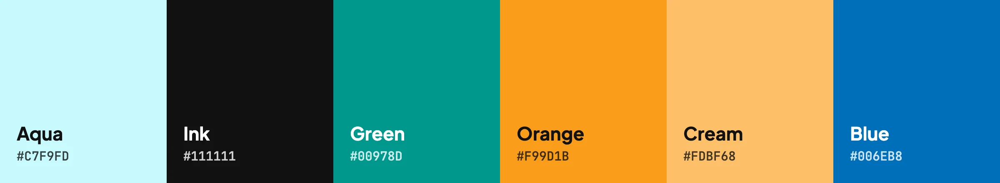

<p align="center">
  <a href="https://good-snout-site.vercel.app"></a>
</p>

<h1 align="center">Good Snout</h1>

<p align="center">
  A landing page for a fresh dog food brand, drawn by hand and brought to life on scroll.
  <br><br>
  <a href="https://good-snout-site.vercel.app"><b>Visit the live site →</b></a>
</p>

<p align="center">
  
  
  
  
  
</p>

<br>

## The page

<table>
  <tr>
    <td width="50%"></td>
    <td width="50%"></td>
  </tr>
  <tr>
    <td width="50%"></td>
    <td width="50%"></td>
  </tr>
</table>

<p align="center"></p>

<br>

## How it was designed



1. **Study, don't copy.** Took the feel from sites in the [Awwwards directory](https://www.awwwards.com/directory/) and the references Stitch suggested, then gave the brand its own name, voice and art.
2. **Screens in Stitch.** Each section was laid out and iterated in Google Stitch before any code.
3. **Art in Figma.** Every drawing was generated one subject at a time in Figma AI, in a single ink style, then cut out and coloured behind the lines.
4. **Built by hand.** Plain HTML and CSS, with GSAP and Lenis for scroll that feels weighted.
5. **Checked like a release.** Headless runs on desktop and phone, a slow-network test for the loader, and zero sideways scroll.

## Design principles

| | |
|---|---|
| **Ink first** | Black hand-drawn lines carry the brand. Colour sits behind the ink, never on top. |
| **One palette** | Six colours, all from one page of Sanzo Wada's *A Dictionary of Color Combinations*. |
| **Motion that draws** | Things are wiped and drawn into place as you scroll, not just faded in. |
| **Calm and readable** | Short lines, generous space, one idea per section. |
| **Fast on bad networks** | A real loader that tracks images and fonts, WebP everywhere, nothing that blocks. |

<p align="center"></p>

## Built with

| Part | Tools |
|---|---|
| Design | Google Stitch (screens), Figma AI (illustrations), Wada No. 267 (colour) |
| Type | Plus Jakarta Sans, Gaegu |
| Motion | GSAP 3.12 + ScrollTrigger, Lenis 1.1 |
| Site | Static HTML, CSS and JS, WebP images |
| Hosting | Vercel, deploys on every push to `main` |

## Run it locally

```bash
python3 -m http.server 8765
```

Then open http://localhost:8765.

<br>

<p align="center"><sub>Designed and built by <a href="https://github.com/hexabytecode">Aditya Uphade</a>. Good Snout is a made-up brand for a design study.</sub></p>
